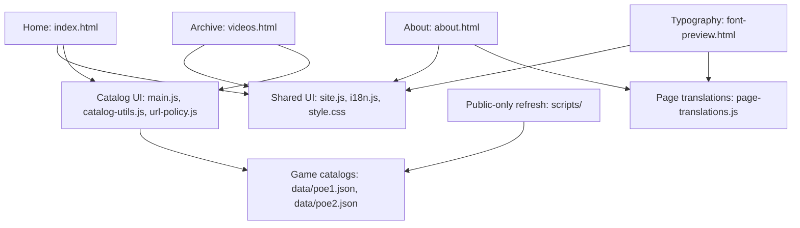

# MistDory public v0.0.1 (internal v5.5) — Feature map

Use the matching entry when a feature's location is unclear. If a file or symbol is already known, open it directly. Paths are relative to this directory; search the named symbols and read their surrounding implementation. This map routes investigation rather than requiring every listed file to be read.

## Architecture overview

The feature table below identifies specific functions, selectors and data keys. The runtime notes explain script order and shared-page dependencies.

## Feature entry points

| Requested area | Start here | Related implementation and search anchors |
| --- | --- | --- |
| Header, navigation, Support Mist, Videos and Soon | Navigation markup in [index.html](index.html), [videos.html](videos.html) and [about.html](about.html) | [style.css](css/style.css): `.nav-links`, `.nav-cta`, `.nav-soon`, `.nav-actions`; shared behavior and link state in [site.js](js/site.js). Update the corresponding shared markup on each affected page. |
| Builds popup and destinations | [site.js](js/site.js): `buildTriggers`, `buildsDialog`, `data-build-game` | [style.css](css/style.css): `.builds-dialog`, `.build-choice`; shared copy in [i18n.js](js/i18n.js). Triggers are in the three main pages' headers. |
| EN/VN control and language preference | [i18n.js](js/i18n.js): `preferredLanguage()`, `setLanguage()`, `apply()`, `MistI18n` | Control creation in [site.js](js/site.js): `languageHost`, `data-language`; [style.css](css/style.css): `.language-switch`, `.language-slider`, `html[lang="vi"]`. Storage key `mistdory.language`, URL key `lang`, event `mistdory:languagechange`. |
| Translated labels, descriptions and messages | Shared interface strings in [i18n.js](js/i18n.js); dynamic catalog/guide strings in [main.js](js/main.js): `CatalogI18n.addTranslations()` | About and typography copy in [page-translations.js](js/page-translations.js). Static markup uses `data-i18n` and translated-attribute variants. Preserve original YouTube titles and source catalog metadata. |
| PoE 1 / PoE 2 switch and remembered game | [main.js](js/main.js): `switchRealm()`, `applyRealm()`; [site.js](js/site.js): `getPreferredRealm()`, `rememberRealm()` | `#btnPoe1`, `#btnPoe2`, `#realmSlider`, `#realmLabel`; CSS `.realm-*` and `.poe2` variants. Storage key `mistdory.realm`; explicit URL `game` takes priority. |
| Hero name, badges, description, counters and spacing | Hero markup in [index.html](index.html); [main.js](js/main.js): `applyRealm()` | [style.css](css/style.css): `.hero`, `.hero-title`, `.hero-badges`, `.hero-stats`, `.page-shell`, `--content-width`. Realm-specific values are under `meta` in the matching catalog; video counts come from public cards. |
| Home League Start card | [index.html](index.html): `.league-start-card` | Update season, Excalidraw `href` and both GMT+7/UTC `<time>` values together in Home markup. Both cards include a localized roadmap description and decorative inline SVG. PoE 1 has an external arrow; PoE 2 is a non-interactive Soon section with an unknown update time until content is supplied. [style.css](css/style.css) selects each `data-league-game` card through `html[data-realm]`; labels live in [i18n.js](js/i18n.js). Verify EN/VN, game switching, narrow layout and new-tab destination. |
| Featured video, playback and YouTube fallback | [main.js](js/main.js): featured-card selection inside `applyRealm()`, `setYoutube()` | [index.html](index.html): `#ytWrap`, `#ytPlaceholder`, `#featuredVideoLink`; CSS `.yt-*`, `.featured-video-actions`. Data keys `meta.ytId`, `meta.ytHint`, `cards[].id`, `privacyStatus`. Retain the player when changing only language. |
| WIP Projects, Document, Leveling/Crafting and Miscellaneous | `guideRows` in [poe1.json](data/poe1.json) or [poe2.json](data/poe2.json) | `gc1` = WIP, `gc2` = Document, `gc3` = Leveling for PoE 1 / Crafting Recipes for PoE 2, `gc4` = Miscellaneous. Rendering in [main.js](js/main.js): `applyRealm()`; CSS `.guide-card`, `.guide-row-link`, `.guide-soon`. Curated label translations also live in `main.js`. |
| Video cards, Home limit and All videos | [main.js](js/main.js): `renderCards()`, `VIDEO_PREVIEW_LIMIT`, `IS_ARCHIVE` | [index.html](index.html): `#allVideosBtn`, `#cardGrid`; [videos.html](videos.html): `data-page="videos"`, `#cardGrid`; CSS `.card-*`, `.videos-header`, `.all-videos-btn`. Home currently shows six cards. |
| Search, categories and sorting | [catalog-utils.js](js/catalog-utils.js): `matchesSearch()`, `normalizeText()`, `sortVideos()`, `getAvailableCategories()` | [main.js](js/main.js): `filterCards()`, `updateCategoryOptions()`, `updateSortOptions()`, `renderCards()`; `#searchInput`, `#catFilter`, `#sortFilter`. Preserve the Blood Mage/Mageblood distinction and functional multilingual search fixtures. |
| Archive pagination, URL state and Back/Forward | [main.js](js/main.js): `restoreViewState()`, `viewValues()`, `writeViewUrl()`, `renderPagination()`, `popstate` listener | [catalog-utils.js](js/catalog-utils.js): `paginate()`, `MAX_PAGE_SIZE` (ten); [videos.html](videos.html): `#videoPagination`, `#pageStatus`; [site.js](js/site.js): `siteUrl()`, `syncRealmLinks()`. Language changes also interact with URL restoration. |
| Catalog loading, validation, errors and retry | [main.js](js/main.js): `validateCatalog()`, `loadRealm()`, `init()`, `showCatalogState()`, `retryRealm()` | `LOAD_STATE`, `CATALOG_TIMEOUT_MS`; both main pages have `#catalogStatus`, `#catalogStatusText`, `#retryCatalogBtn`. Keep independent game loading, timeout, stale-content clearing and safe late-response handling. |
| About text, avatar placeholder, sources and accounts | [about.html](about.html), [about.css](css/about.css) | Translation strings in [page-translations.js](js/page-translations.js); shared header/footer rules still use `style.css` and `site.js`. Personal avatar content remains pending. YouTube references written in About are currently outside the catalog refresh audit. |
| Fixed resource footer and bottom clearance | `.resource-dock` markup in the three main HTML pages; [site.js](js/site.js): `updateDockHeight()` | [style.css](css/style.css): `.resource-dock`, `.resource-dock-inner`, `--dock-height`; `ResizeObserver` and font/resize listeners. Footer About links also carry game/language state. |
| Fonts, colors, hover and layout | [style.css](css/style.css): local font import, `:root`, heading selectors, `--accent`, `--accent-hover`, `--content-width` | Font faces in [fonts.css](css/fonts.css), licensed assets and hashes in [font sources](assets/fonts/SOURCES.md). Search later overrides, `.poe2` variants, media queries and Vietnamese heading rules. [about.css](css/about.css) and [font-preview.css](css/font-preview.css) add page-specific rules. |
| Typography comparison page | [font-preview.html](font-preview.html), [font-preview.js](js/font-preview.js), [font-preview.css](css/font-preview.css) | `fontOptions`, `selectFont()`, `markFont()`, `refreshFontStatuses()`; [page-translations.js](js/page-translations.js) for copy. Preview selection affects the comparison page; Niagara samples depend on locally installed fonts. |
| YouTube import, public-only eligibility and update timestamp | [refresh workflow](scripts/README.md), [refresh-videos.cjs](scripts/refresh-videos.cjs) | `loadPlaylist()`, `auxiliaryIds()`, `makeCatalog()`, `writeTransaction()`, `refresh()`; [catalog-lib.cjs](scripts/catalog-lib.cjs): `parseWatchPage()`, `assertPublicProof()`, `verifyCatalogs()`. UI timestamp rendering is `updateCatalogTime()` in `main.js`. |
| Link/image safety and Discord isolation | [url-policy.js](js/url-policy.js): `safeExternalUrl()`, `safeImageUrl()` | [main.js](js/main.js): `applyRealm()`, `renderCards()`, Discord callbacks; [catalog-lib.cjs](scripts/catalog-lib.cjs): offline URL checks. Preserve placeholders and current valid HTTPS links. |
| CSP, resource permissions and event binding | Early CSP/referrer meta tags in all four HTML pages; [main.js](js/main.js): `bindCatalogControls()` | Local scripts/fonts, YouTube thumbnail hosts and the fixed embed host are allowed. [security-browser-review.cjs](tests/security-browser-review.cjs) checks the production policy, unsafe URL rejection, fonts and fallback images. |
| Thumbnail failures and local fallback | [main.js](js/main.js): `LOCAL_VIDEO_THUMBNAIL`, `renderCards()`, capturing image-error listener in `bindCatalogControls()` | [video-placeholder.svg](assets/images/video-placeholder.svg); chain is custom image to YouTube thumbnail to local SVG, with no retry loop. |
| Development Live Server and reload | [preview-live.cjs](scripts/preview-live.cjs): `developmentHtml()`, `createPreviewMiddleware()`, `isAllowedUpgrade()`, `startPreview()` | [live-reload-client.js](scripts/live-reload-client.js) is injected only into local responses. [live-preview.test.cjs](tests/live-preview.test.cjs) covers CSP transformation and loopback/Host/Origin/path boundaries. |

## Runtime and shared dependencies

- This is a static HTML/CSS/JavaScript website with JSON catalogs and no package/build step.
- Home and All videos load the production CSP before `i18n.js` in the head, then `site.js`, `catalog-utils.js`, `url-policy.js` and `main.js` at the end of the body. The archive is identified by `body[data-page="videos"]`.
- About loads `i18n.js`, `page-translations.js` and `site.js`; its content is authored in HTML. The typography page adds `font-preview.js` and its own CSS.
- Headers and resource footers are repeated HTML rather than generated shared templates. JavaScript creates the Builds dialog and EN/VN control. A shared-header change can therefore involve multiple HTML pages plus `site.js` and shared CSS.
- `main.js` owns catalog/view state and rendering; `catalog-utils.js` owns search/sort/pagination helpers; `site.js` owns shared page behavior; `i18n.js` owns language state. Cross-cutting changes can require more than one entry.
- `url-policy.js` is shared by browser rendering and Node catalog verification. `style.css` imports same-origin `fonts.css`; browsers request only the licensed font subsets actually used. GitHub Pages serves these static resources and does not run the preview/release scripts.
- Inspect the current implementation when a pointer is stale. Update the affected map entry after moving or renaming an entry point; avoid broad refactors merely to make a small change fit this map.

## Data ownership

Both catalogs have `meta`, `guideRows`, `cards` and `source`. Inspect the requested object or record rather than dumping both full catalogs.

- `meta`: game labels, description, Discord links and featured selection. `meta.ytId` must refer to an existing verified public card in the same game.
- `guideRows.gc1` through `gc4`: curated panel titles and rows. A placeholder is not proof of active work; remove Soon only when actual content and a usable destination exist. Refresh preserves these groups and audits their YouTube links.
- `cards`: imported videos plus curated descriptions, tags and presentation fields. New videos come from the public-only playlist refresh; IDs, publication dates, view counts and verification fields belong to the importer. See the refresh instructions before editing generated fields.
- `source`: import/audit/metrics timestamps and refresh results. Browser reload fetches the published snapshot; it does not perform a new YouTube audit. Do not replace the recorded audit time with page-load time.

## Verification routes

Choose checks according to the changed behavior. Commands below run from this version's directory with Node available; see the [README verification instructions](README.md#verification) and [refresh launcher instructions](scripts/README.md) for details.

| Change | Appropriate starting check |
| --- | --- |
| Instructions or documentation only | Verify referenced files/symbols and relative links, inspect the diff and check whitespace. No application suite is needed for prose-only changes. |
| Localized copy, shared header, Builds, About or language state | Targeted preview on affected pages in EN/VN; use [language-browser-review.cjs](tests/language-browser-review.cjs) for relevant shared behavior or language regressions. |
| Isolated layout, font, color or hover | Inspect the affected component and shared pages/game/language variants visually. Broaden browser testing when shared layout or behavior changes. |
| Search, sorting, categories or page calculations | `node --test tests/catalog-utils.test.cjs`; preview the affected Home/archive behavior when integration changes. |
| Loading, rendering, game switching, URL state or retry | `node --test tests/catalog-loading.test.cjs`; add relevant browser checks when DOM/history/language interactions change. |
| Curated catalog data | `node scripts/verify-catalog.cjs` plus a focused preview. New or changed YouTube entries must follow the public-only refresh workflow. Offline validation does not establish current visibility. |
| Refresh parsing, transactions or eligibility | `node scripts/self-test.cjs` and offline catalog validation; use the documented networked dry run when validating live refresh behavior. |
| Broad English desktop UI regression | [qc-browser-review.cjs](tests/qc-browser-review.cjs), alongside language checks when bilingual behavior is affected. |
| Actual featured-video playback | [featured-video-diagnostic.cjs](tests/featured-video-diagnostic.cjs); this requires a running preview, Chrome and outbound YouTube access. Interface checks alone do not establish media playback. |
| URL validation, production CSP, font resources or fallback | `node --test tests/url-policy.test.cjs`, then [security-browser-review.cjs](tests/security-browser-review.cjs) against the plain helper. Set `MISTDORY_QA_NETWORK=1` for all catalog thumbnail downloads/decodes. |
| Live Server adapter or reload client | `node --test tests/live-preview.test.cjs`; then [live-reload-browser-review.cjs](tests/live-reload-browser-review.cjs) against the interactive launcher, with `MISTDORY_QA_URL` set to its origin. Source HTML must retain the production policy. |

### Preview and local tool notes

- Run `node scripts/preview-live.cjs` for interactive Live Server development at `http://127.0.0.1:8003/`. It finds the installed module/VS Code extension or accepts `MISTDORY_LIVE_SERVER_MODULE`; `PORT` selects another available port. Avoid the extension's ordinary inline injection, which is blocked by the production CSP.
- For unchanged production-policy checks, use [local-preview.cjs](tests/local-preview.cjs) on a separate port. The adapter injects an external local client and adds only its local WebSocket to preview responses; source files remain unchanged. Home/archive JSON fetching requires HTTP, not `file://`.
- Browser runners use `MISTDORY_QA_URL` to select the preview origin; for example, point it to port 8004 when interactive Live Server occupies 8003. They also support `MISTDORY_QA_CHROME`; the language and desktop QC runners support `MISTDORY_QA_TEMP` for artifacts.
- On the currently inspected Windows machine, Node/npm are absent from PATH. The installed VS Code runtime is available at `%LOCALAPPDATA%\Programs\Microsoft VS Code\Code.exe` with `ELECTRON_RUN_AS_NODE=1`. Run it from the OS temporary directory with absolute script paths to avoid generated logs in the repository. Background helpers should use hidden windows; use waited processes with redirected logs when checking their exit status.
- For a long-running VS Code-runtime preview, use a hidden `Start-Process` with stdout/stderr redirected to temporary log files and retain its PID. This keeps logging available after the launching command finishes; test processes should instead be waited on before reading their exit status.
- Browser startup, network access or Git writes may require the execution environment's normal approval mechanism. Repository instructions do not bypass those permissions.

## Progress, history and maintenance

- For a new-session briefing, start with [HANDOFF.md](HANDOFF.md), then verify Git state. For a known small feature edit, use its entry point directly.
- Use [STATUS.md](STATUS.md) for current delivery, pending content and deferred features; use [CHANGELOG.md](CHANGELOG.md) for historical differences and [README.md](README.md) for full setup/publishing instructions. Consult them when the task needs that information.
- For security hardening or release-security work, consult the relevant finding in [SECURITY_REVIEW.md](SECURITY_REVIEW.md). It separates tested application behavior from unverified hosting/account controls and links to the affected source files.
- Keep this map focused on stable locations and dependencies. Do not duplicate video catalogs, test artifacts or a running task log here.
- When creating a new active version, adapt its map and update the active-version path/link in the repository-root [AGENTS.md](../AGENTS.md). Earlier versions remain historical unless the user requests work on them.
